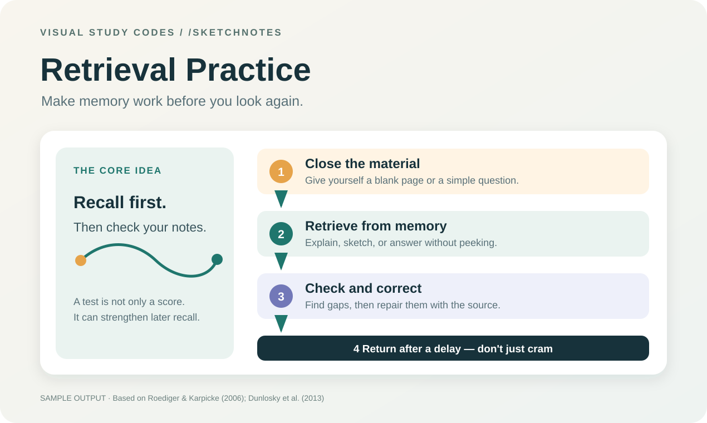
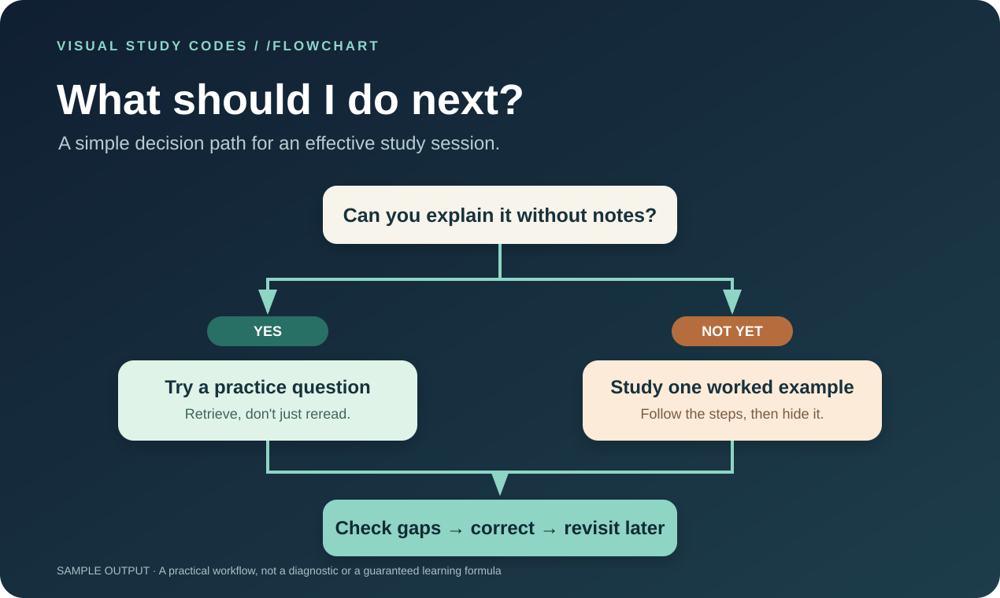
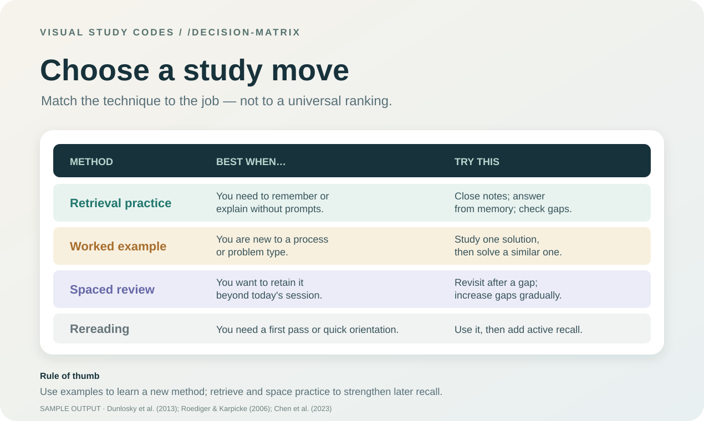
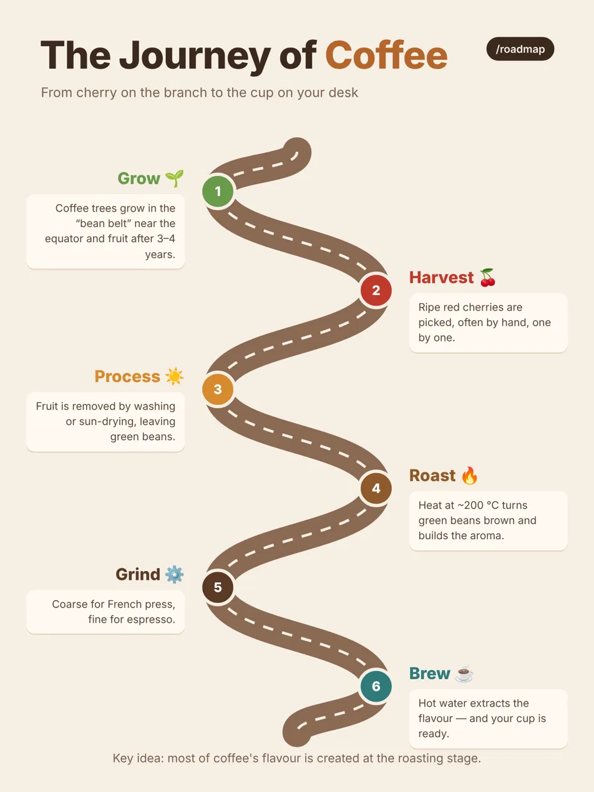
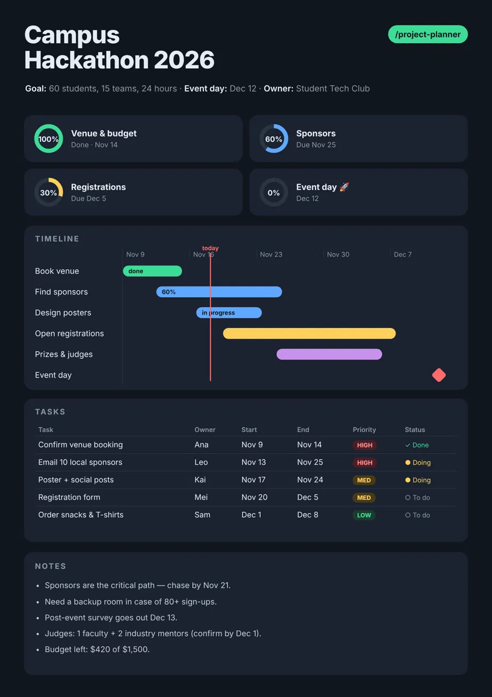
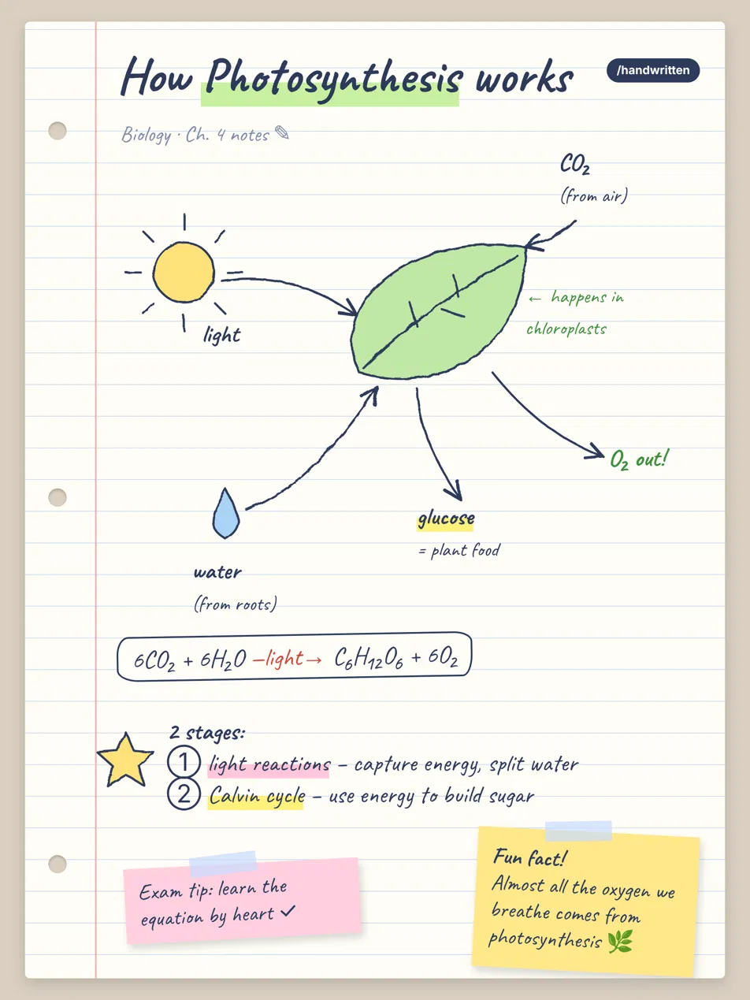
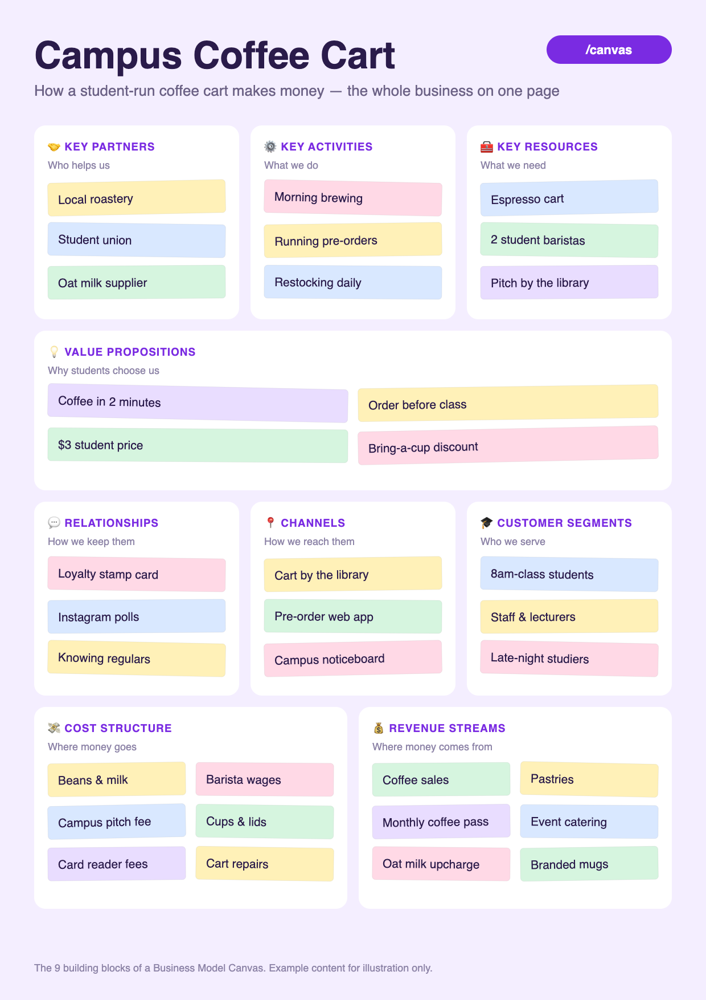

# visual-study-codes

A cross-platform visual-learning Agent Skill for Claude and OpenAI Codex, with a guided setup for ChatGPT. Turn topics, source text, and personal schedules into study visuals or planners using 16 slash codes.

一个面向 Claude、OpenAI Codex，并提供 ChatGPT 使用指南的跨平台视觉学习 Skill：输入斜杠代码 + 主题、文本或个人计划，就能生成学习图或计划表，共 16 种版式。

## See it in action / 效果预览

These are sample outputs created by following the project's `SKILL.md` instructions. They are demonstrations, not user testimonials.

以下是按项目 `SKILL.md` 规则制作的示例输出，用于展示实际版式，不代表用户评价或第三方测试结果。

| `/sketchnotes` | `/flowchart` |
|---|---|
|  |  |

| `/decision-matrix` |
|---|
|  |

**Try the exact inputs / 可直接尝试：**

- `/sketchnotes retrieval practice`
- `/flowchart what should I do next in a study session`
- `/decision-matrix compare retrieval practice, worked examples, spaced review and rereading`

The learning-science content in these examples is based on [Roediger & Karpicke (2006)](https://doi.org/10.1111/j.1467-9280.2006.01693.x), [Dunlosky et al. (2013)](https://doi.org/10.1177/1529100612453266), and [Chen et al. (2023)](https://doi.org/10.1080/01443410.2023.2273762). These sources support the example content, not claims that this Skill itself improves learning outcomes.

**Try it and leave feedback:** [Open a GitHub feedback issue](https://github.com/kkkkkkkaro-cyber/visual-study-codes/issues/2).


## Install / 安装

### Claude

**Claude app (web / desktop)**

1. Click **Code → Download ZIP**, unzip, then re-zip the folder so that `SKILL.md` sits inside a `visual-study-codes` folder.
2. In Claude settings, open **Skills** and upload the ZIP.

**Claude Code**

```bash
git clone https://github.com/kkkkkkkaro-cyber/visual-study-codes ~/.claude/skills/visual-study-codes
```

### OpenAI Codex

Codex uses the same root-level `SKILL.md`. The skill instructions and all 16 visual codes are shared; no separate implementation is needed.

**Install for your user (available across projects)**

```bash
mkdir -p ~/.agents/skills
git clone https://github.com/kkkkkkkaro-cyber/visual-study-codes ~/.agents/skills/visual-study-codes
```

**Install for one project (available in that project)**

Run this from your project root:

```bash
mkdir -p .agents/skills
git clone https://github.com/kkkkkkkaro-cyber/visual-study-codes .agents/skills/visual-study-codes
```

Codex discovers skills from these locations. If the skill does not appear, restart Codex. You can explicitly invoke it with `$visual-study-codes` in Codex CLI/IDE, or use `/skills` to inspect available skills. You can also describe the visual you want and let the skill's description help Codex select it.

See the [official Codex Skills documentation](https://developers.openai.com/codex/skills/) for current discovery and installation details.

### ChatGPT

**ChatGPT does not automatically install or load a GitHub `SKILL.md` as a native Skill.** Use the ChatGPT adaptation guide to set up the same 16 visual codes in a conversation, or add the instructions to a custom GPT.

**Quick start**

1. Open [CHATGPT.md](CHATGPT.md).
2. Copy the section titled **ChatGPT master instructions** into a new ChatGPT conversation.
3. After ChatGPT receives the instructions, enter a command such as:
   - `/flowchart how photosynthesis works`
   - `/timeline the history of Korean baseball`
   - `/sketchnotes` followed by your notes or an article
4. For repeated use, add the master instructions to the **Instructions** field when configuring a custom GPT (if custom GPT creation is available to you).

This is a prompt-based adaptation, not a one-click native Skill installation. The visual codes and design rules are adapted from the shared project instructions; ChatGPT chooses an appropriate output format based on the tools available in the conversation.

**中文说明：** ChatGPT 目前不会因为仓库里有 `SKILL.md` 就自动加载它。请打开 [CHATGPT.md](CHATGPT.md)，复制其中的 **ChatGPT master instructions** 到新对话，然后像平时一样输入 16 个代码。若希望重复使用，可以把指令放进自定义 GPT 的 Instructions 中（如果你的账号支持创建自定义 GPT）。

## Usage / 用法

Type a slash code followed by your input. The input can be:

- **Just a topic / 只给主题**: e.g. `/roadmap coffee from bean to cup`. The assistant works out 4–8 key steps and checks numbers and dates before drawing.
- **A block of text / 一段文字**: e.g. `/sketchnotes` followed by lecture notes or an article. The assistant extracts the key points and draws them.
- **Your own schedule / 计划类**: e.g. `/weekly-plan report due Wed, dinner with friends Fri, run 30 min daily`. Only what you provide is filled in; empty slots stay blank and no tasks are invented.

No code? Send just a topic or text and the assistant suggests 2–3 fitting codes. Text in the visual follows the language you write in.

输入斜杠代码 + 内容，内容可以是主题、一段文字或自己的计划。没有指定代码时，助手会推荐 2–3 个合适的代码。图中文字跟随输入语言。

## Codes / 代码一览

| Code 代码 | Layout 版式 | Best for 适合 |
|---|---|---|
| `/blueprint` | Navy engineering blueprint, numbered callouts<br>深蓝底工程蓝图，编号 + 引线标注 | Systems, machines, structures<br>系统、机器、结构 |
| `/roadmap` | Winding road with 5–8 stops<br>蜿蜒道路 + 5–8 个编号站点 | Learning paths<br>阶段性过程、学习路径 |
| `/handwritten` | Handwritten notes on cream paper + sticky notes<br>米色纸底手写笔记 + 黄色便签 | Revision notes<br>笔记、复习提纲 |
| `/decision-matrix` | Options × criteria score table with a winner<br>选项 × 指标打分表，选出赢家 | Comparing options<br>多选项比较 |
| `/flowchart` | Top-down nodes with decision diamonds<br>自上而下节点 + 菱形判断分支 | Conditional processes<br>带条件的流程 |
| `/infographic` | Magazine-style long page with side stats<br>杂志式长图，分段 + 侧边小数据 | Overviews<br>主题概览 |
| `/canvas` | Business Model Canvas with sticky notes<br>商业模式画布九宫格 + 便利贴 | Business analysis<br>商业分析 |
| `/layers` | Labeled cross-section layers<br>纵向剖面分层 + 引线标注 | Layered systems<br>组成结构、分层系统 |
| `/cycle` | Stages in a ring<br>环形阶段，箭头首尾相连 | Cycles<br>循环过程 |
| `/diagram` | Central concept + linked parts<br>中心概念 + 组件 + 带标签连线 | Concept relations<br>概念关系 |
| `/sketchnotes` | Hand-drawn visual notes<br>手绘风视觉笔记 | Lecture / book summaries<br>讲座 / 书籍总结 |
| `/exploded-view` | Parts spread along an axis<br>部件沿轴线分开的爆炸图 | Taking things apart<br>拆解产品或结构 |
| `/tree` | Branching hierarchy<br>根节点逐级分支的树状图 | Classification<br>分类、谱系、层级 |
| `/timeline` | Events on a time axis<br>时间轴 + 年份 + 事件 + 意义 | History<br>历史、演进 |
| `/weekly-plan` | Journal-style week page + habit tracker<br>手帐风周计划页 + 习惯打卡 | Weekly planning<br>一周安排 |
| `/project-planner` | Milestones + Gantt + task table<br>里程碑 + 甘特图 + 任务表 | Project scheduling<br>项目排期 |

## More layout previews / 更多版式预览

The older images below use illustrative content to show additional layouts. The three sample outputs above use a sourced learning topic and practical study workflow.

下方旧示例使用虚构内容展示其他版式；上方三个新示例则围绕有来源的学习主题和实际学习流程制作。

<table>
  <tr>
    <th width="50%"><code>/roadmap</code></th>
    <th width="50%"><code>/decision-matrix</code></th>
  </tr>
  <tr>
    <td align="center" width="50%"></td>
    <td align="center" width="50%"></td>
  </tr>
  <tr>
    <th width="50%"><code>/weekly-plan</code></th>
    <th width="50%"><code>/project-planner</code></th>
  </tr>
  <tr>
    <td align="center" width="50%"></td>
    <td align="center" width="50%"></td>
  </tr>
  <tr>
    <th width="50%"><code>/handwritten</code></th>
    <th width="50%"><code>/canvas</code></th>
  </tr>
  <tr>
    <td align="center" width="50%"></td>
    <td align="center" width="50%"></td>
  </tr>
</table>

## License / 许可证

[MIT](LICENSE)
