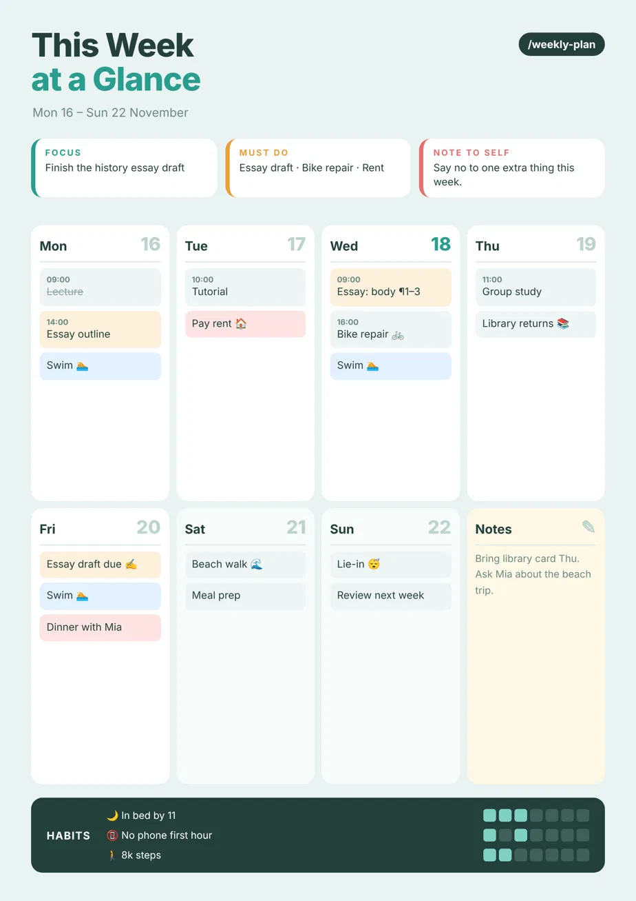

# visual-study-codes

A Claude skill that turns any topic into a study visual or planner with 16 slash codes.

一个 Claude skill：输入斜杠代码 + 主题，就把主题画成学习图或计划表，共 16 种版式。

## Install / 安装

**Claude app (web / desktop) · Claude 网页版 / 桌面版**

1. Click **Code → Download ZIP**, unzip, then re-zip the folder so that `SKILL.md` sits inside a `visual-study-codes` folder.
   点 **Code → Download ZIP** 下载并解压，再把文件夹重新压缩成 zip，确保 `SKILL.md` 在 `visual-study-codes` 文件夹里。
2. In Claude's settings, open the Skills page and upload the zip.
   在 Claude 设置里的 Skills 页面上传这个 zip。

**Claude Code**

```bash
git clone https://github.com/kkkkkkkaro-cyber/visual-study-codes ~/.claude/skills/visual-study-codes
```

## Usage / 用法

Type a slash code followed by your input. The input can be:
输入斜杠代码 + 内容，内容可以是：

- **Just a topic / 只给主题**: e.g. `/roadmap coffee from bean to cup`. Claude works out 4–8 key steps itself and checks numbers and dates before drawing.
  例如 `/roadmap 咖啡从豆到杯`。Claude 会自己整理 4–8 个关键步骤再画，遇到数字、日期这类信息会先查证。
- **A block of text / 一段文字**: e.g. `/sketchnotes` followed by your lecture notes or an article. Claude pulls out the key points and draws them.
  例如 `/sketchnotes` 后面贴上你的课堂笔记或一段文章。它会从里面提炼要点，画成对应的图。
- **Your own schedule / 计划类**: e.g. `/weekly-plan report due Wed, dinner with friends Fri, run 30 min daily`. Only what you give is filled in; empty slots stay blank and no tasks are invented.
  例如 `/weekly-plan 周三交报告，周五和朋友吃饭，每天跑步30分钟`。它只用你给的安排来填表，没写到的格子会留空，不会替你编任务。

No code? Send just a topic or text and Claude suggests 2–3 fitting codes. Text in the visual follows the language you write in.
不写代码也行：只发主题或文字，Claude 会推荐 2–3 个合适的代码让你选。图里的文字跟随你输入的语言。

## Codes / 代码一览

| Code 代码 | Layout 版式 | Best for 适合 |
|---|---|---|
| `/blueprint` | Navy engineering blueprint, numbered callouts<br>深蓝底工程蓝图，编号 + 引线标注 | Systems, machines<br>系统、机器、结构 |
| `/roadmap` | Winding road with 5–8 stops<br>蜿蜒道路 + 5–8 个编号站点 | Learning paths<br>阶段性过程、学习路径 |
| `/handwritten` | Handwritten notes on cream paper + sticky notes<br>米色纸底手写笔记 + 黄色便签 | Revision notes<br>笔记、复习提纲 |
| `/decision-matrix` | Options × criteria score table with a winner<br>选项 × 指标打分表，选出赢家 | Comparing options<br>多选项比较 |
| `/flowchart` | Top-down nodes with decision diamonds<br>自上而下节点 + 菱形判断分支 | Conditional processes<br>带条件的流程 |
| `/infographic` | Magazine-style long page with side stats<br>杂志式长图，分段 + 侧边小数据 | Overviews<br>主题概览 |
| `/canvas` | Business Model Canvas with sticky notes<br>商业模式画布九宫格 + 便利贴 | Business analysis<br>商业/项目分析 |
| `/layers` | Labeled cross-section layers<br>纵向剖面分层 + 引线标注 | Layered systems<br>组成结构、分层系统 |
| `/cycle` | Stages in a ring<br>环形阶段，箭头首尾相连 | Cycles<br>循环过程 |
| `/diagram` | Central concept + linked parts<br>中心概念 + 组件 + 带标签连线 | Concept relations<br>概念关系 |
| `/sketchnotes` | Hand-drawn visual notes<br>手绘风视觉笔记 | Lecture / book summaries<br>讲座/书籍总结 |
| `/exploded-view` | Parts spread along an axis<br>部件沿轴线分开的爆炸图 | Taking things apart<br>拆解产品或结构 |
| `/tree` | Branching hierarchy<br>根节点逐级分支的树状图 | Classification<br>分类、谱系、层级 |
| `/timeline` | Events on a time axis<br>时间轴 + 年份 + 事件 + 意义 | History<br>历史、演进 |
| `/weekly-plan` | Journal-style week page + habit tracker<br>手帐风周计划页 + 习惯打卡 | Weekly planning<br>一周安排 |
| `/project-planner` | Milestones + Gantt + task table<br>里程碑 + 甘特图 + 任务表 | Project scheduling<br>项目排期 |

## Examples / 示例

All content in these examples is made up to show the layouts.
示例图中的内容均为虚构，仅用于展示版式。

| `/roadmap` | `/decision-matrix` |
|---|---|
|  |  |
| **`/weekly-plan`** | **`/project-planner`** |
|  |  |

<p align="center"><b><code>/handwritten</code></b><br></p>

## License / 许可证

[MIT](LICENSE)
